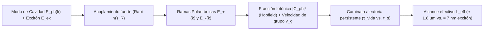

# Polaritones para mover excitaciones (v1.1)

---

## ✨ Descripción General

Simulador de **excitón–polaritones en microcavidad** (cuasipartículas híbridas luz–materia) como mecanismo para transportar energía de excitación a distancias micrométricas, superando el corto alcance difusivo de los excitones orgánicos o semiconductores puros.

> [!IMPORTANT]
> **Estado del proyecto:** Hipótesis de ingeniería / modelo de orden de magnitud. No es un resultado experimental ni un dispositivo real.

👉 **[Probar el Simulador Interactivo en Vivo](https://mathigza1211.github.io/energia-polaritones/)** *(explora el desdoblamiento de Rabi $\hbar\Omega_R$, coeficientes de Hopfield y la transición balístico–difusiva).*

---

## ⚛️ Física de Acoplamiento Fuerte Luz–Materia

### Ecuaciones y Parámetros del Simulador

| Aspecto Físico | Implementación |
| :--- | :--- |
| **Hamiltoniano $2\times 2$** | Dos osciladores acoplados con dispersión parabólica de cavidad (masa efectiva $m_{\text{eff}}$), ramas $E_\pm(k)$ y factores de mezcla de **Hopfield** ($|C_{\text{ph}}|^2, |C_{\text{ex}}|^2$). |
| **Tiempo de Vida ($\tau_{\text{LP}}$)** | Combinación ponderada del factor de calidad óptico $Q$ de la cavidad y la vida no radiativa del excitón. |
| **Transporte Híbrido** | Modelo de **caminata aleatoria persistente** gobernado por el tiempo de dispersión por desorden $\tau_s$, interpolando suavemente entre el régimen **balístico** y el **difusivo**. |
| **Comparación en Caso Base** | Alcance máximo del polaritón **$\approx 1.8\text{ }\mu\text{m}$** frente a solo **$\approx 7\text{ nm}$** para el excitón desnudo. |

---

## ⚠️ Límites y Contexto Experimental

> [!WARNING]
> - **Sensibilidad extrema a $\tau_s$:** Es una estimación de orden de magnitud, no de un material específico; el alcance predicho depende fuertemente del tiempo de dispersión libre $\tau_s$ asumido.
> - **Rango amplio en la literatura:** Los alcances medidos experimentalmente varían desde $\approx 0.27\text{ }\mu\text{m}$ (*Pandya et al.*, `arXiv:1909.03220`) hasta más de $100\text{ }\mu\text{m}$ en guías de onda/bloques optimizados (*Hou et al.*, *Adv. Mater.* 2020). El caso base del simulador es genérico.
> - **Excitación $\neq$ Corriente eléctrica:** Transportar una excitación neutra no equivale a transmitir potencia eléctrica; disociar el polaritón en cargas libres introduce pérdidas adicionales de energía e interfaz.

---

## 📄 Archivos del Repositorio

| Archivo | Descripción |
| :--- | :--- |
| [`index.html`](index.html) | Simulador interactivo de curvas de dispersión $E_\pm(k)$, velocidad de grupo y alcance espacial. |
| [`informe-3-polaritones-transporte-energia.docx`](informe-3-polaritones-transporte-energia.docx) | Informe técnico con el modelo de Hopfield, transporte balístico–difusivo y referencias experimentales. |

---

## 👤 Autoría

**Mathias Zárate Amenero** — *Lima, Perú*  
Desarrollado junto con **Claude (Anthropic)** *(código e informes elaborados con asistencia de IA; los supuestos físicos están declarados arriba).*

🔗 **Ver más proyectos:** [Portafolio de Simuladores y Prototipos](https://github.com/mathigza1211/simuladores-portafolio)
